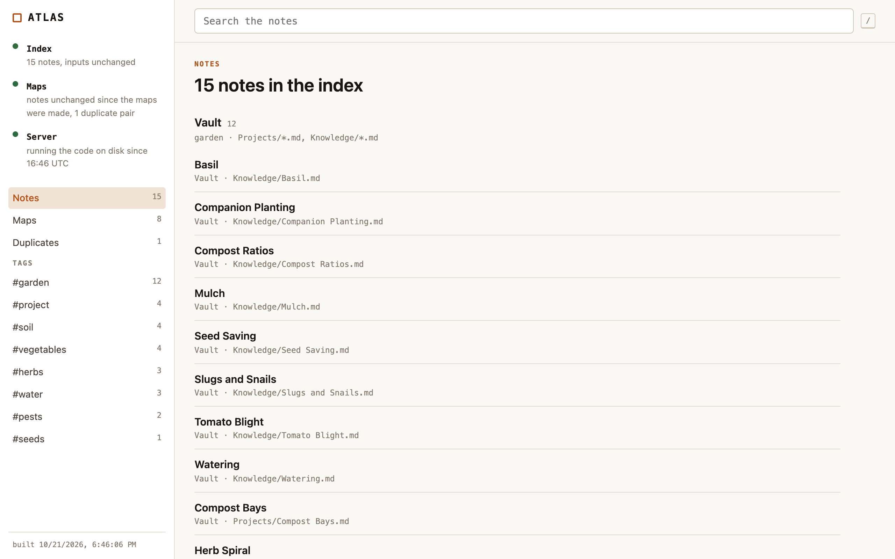
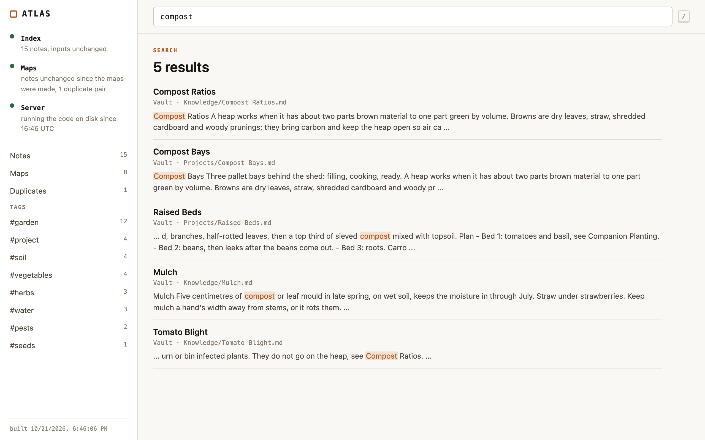
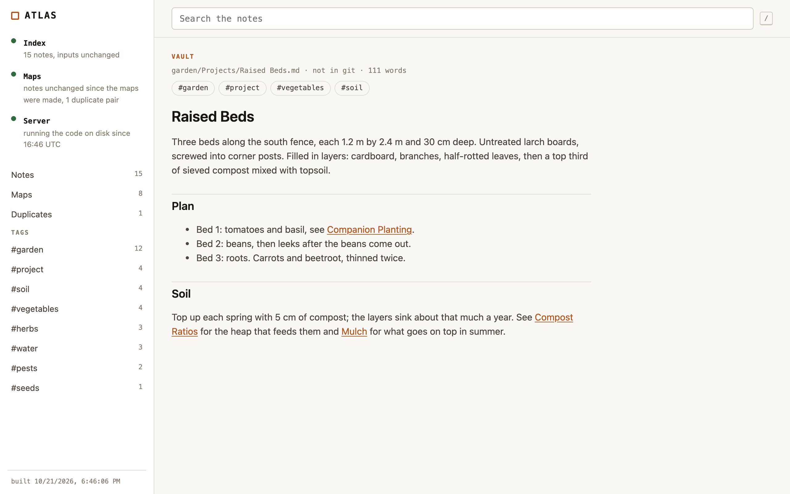
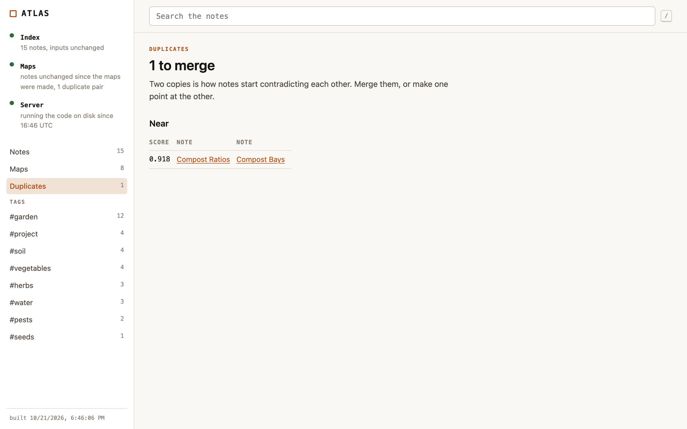
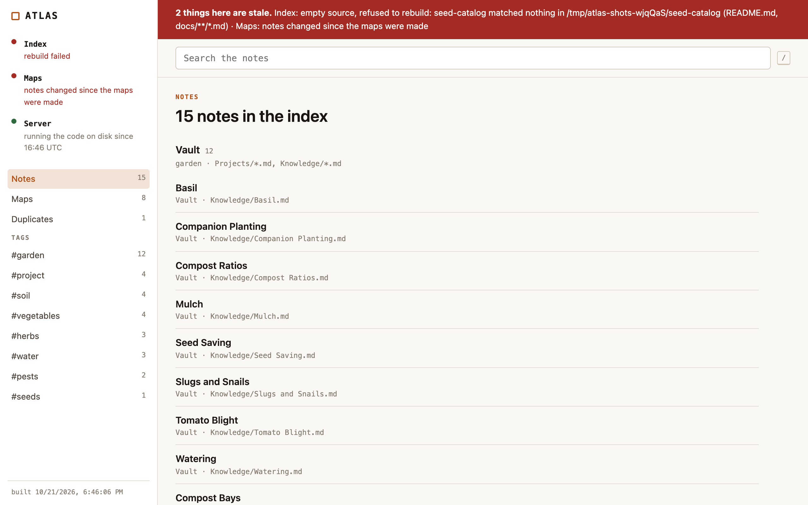

# Atlas

An index for a folder of markdown notes. Atlas reads your notes, builds one
index with the provenance of every entry (folder, file, commit), and shows it
as a small local app: search, notes, maps by tag, and a report of notes that
repeat each other. When the index no longer matches the files on disk, the
page says so in red.



## What it does

- **Indexes** a vault's `Projects/*.md` and `Knowledge/*.md` (daily notes
  repeat themselves too much to be worth indexing), plus any folder you add:
  a repo's `README.md` and its `docs/`.
- **Stays current without a schedule.** The index records a fingerprint of
  the contents of every file it read. Each read of the app compares it with the
  files as they are now and rebuilds when they differ. A rewrite that changes
  nothing is not a change; an edit that keeps the file size is.
- **Says when something is stale.** If a rebuild is refused (a folder you
  added lost all its files, say), the previous index is still served and a red
  banner names the reason. A stale page that says so is honest; a blank one is
  not.
- **Writes maps by tag** into the vault's `Maps/Generated/`: one note per tag
  that sits on at least three notes (and on at most 85% of them), plus a front
  door that links them. Tags come from the frontmatter `tags:` field only
  (`tags: [herbs, project/active]`); `#tags` written in the body are not
  indexed. A leading `#` in the field is dropped. A nested tag gets a flat
  name: `project/active` is mapped in `Project - Active Map.md`. Characters
  that are not safe in a file name become spaces, and two tags that would
  share a name get a number.
- **Leaves your files alone.** Every generated file carries a marker. Anything
  else in that folder (a file without the marker, a symlink, a folder) is
  yours: never removed, overwritten or written through. Atlas writes nowhere
  else in the vault, and refuses a `Maps/Generated` that resolves outside it.
  A map that cannot be written is listed in the front door and the status, and
  the others are still written.
- **Reports duplicates** in `Maps/Generated/Duplicates.md`: identical notes,
  and near copies with their score (8-word shingle Jaccard of 0.82 or more,
  over notes of 120 words or more). Merge them, or make one point at the other.

| | |
|---|---|
|  |  |
|  |  |

## Install from Deck

Atlas is a Deck App. On Deck's **Apps** page, type `zlexo` in the owner box
and press **Watch** (a new Deck watches no accounts), then install **Atlas**.
Its manifest (`deck.json`) asks Deck for two things:

- `vault: true`: Deck passes the vault it manages as `DECK_VAULT`, and lists
  Atlas on the Vault page with its status line ("index current, 12 notes,
  1 duplicate pair").
- `data: true`: Deck gives Atlas a data folder of its own (`DECK_APP_DATA`).
  The config and the index live there, never in the app's folder or a repo.

Start it from Deck. It serves on `127.0.0.1:4317` by default (change the port
in Deck's settings for the app).

## Run it on its own

Node 22.12 or newer, no dependencies.

```sh
node src/cli.js serve  --vault ~/notes --data ~/.local/share/atlas
node src/cli.js build  --vault ~/notes --data ~/.local/share/atlas   # the index, by hand
node src/cli.js status --vault ~/notes --data ~/.local/share/atlas   # exit 1 when anything is stale
node src/cli.js moc    --vault ~/notes --data ~/.local/share/atlas   # maps and the duplicates report
node src/cli.js add ~/code/some-repo --data ~/.local/share/atlas      # index its README.md and docs/
```

`--vault` and `--data` win over `DECK_VAULT` and `DECK_APP_DATA`. `serve`
listens on `127.0.0.1:4317` by default and takes `--port` and
`--no-map-sweep` (leave the vault untouched; the status still says when the
maps are out of date).

## Where it reads and writes

| | |
|---|---|
| reads | the vault's `Projects/` and `Knowledge/`, and the folders you added |
| writes | `<data>/atlas.config.json` (the folders you added), `<data>/bundle.json` (the index), and `<vault>/Maps/Generated/` |
| network | `127.0.0.1` only; the page loads nothing from elsewhere |

The server sweeps stale maps when the status is read, at most once a minute,
so a page left open cannot write into the vault at the rate you type.

## Routes

| | |
|---|---|
| `/` | the app |
| `/bundle.json` | the index, rebuilt first when its inputs changed |
| `/status.json` | every part against its input: the index, the maps, the server's own code |
| `/status-line` | `{ "status": "<one line>" }`, the line Deck shows |

## Development

```sh
npm test                                          # node --test
node scripts/scrub.mjs                            # the publish check, below
node scripts/screenshots.mjs                      # docs/screenshots, in headless Chrome
node scripts/check-deck.mjs --deck <deck checkout>  # install and run through a throwaway Deck
```

The fixtures are a made-up garden notebook (`fixtures/garden`) and a small
docs folder (`fixtures/seed-catalog`).

**The scrub.** This repo's history is meant to be readable as it is, so
`scripts/scrub.mjs` scans the working tree and every commit on every ref
(messages, file names, added and removed lines) for home-folder paths, e-mail
addresses, attribution trailers, em dashes and generated bundles, and for the
strings in a git-ignored `private-strings.local.txt` (one per line; a line
`allow <text>` exempts one exact text). CI runs the generic checks; the
private list runs before every push on the machine that holds it.

**The Deck check.** `scripts/check-deck.mjs` starts a Deck gateway with a
throwaway home, data and config folder and no background jobs, creates a
vault through Deck and fills it with the fixture notes, installs this repo's
committed HEAD with Deck's own installer, starts Atlas through Deck, and
checks that Deck's `GET /api/vault/apps` lists Atlas with its status line,
that the index landed in Deck's data folder for the app, the maps in the
vault, and nothing in the app's folder. `--plant no-vault` and
`--plant no-status` are its controls: each must fail.
